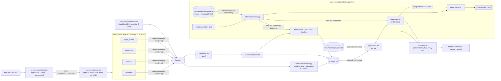

# Architecture — LeetCode Tutor Agent

2026-11-02 · `/architect` · built on `docs/eval-plan.md`, `docs/data/session-format.md`,
and decisions D-001 – D-013.

This document says **how** things are built. What to build is in the eval plan, task
status is in the tracker, and the reasons are in `docs/decisions.md`. If `/build` would
need to invent a convention, this document is missing something — raise it, don't invent.

---

## 0. Read this first: where the data breaks the plan

| # | Plan says | Data says | Resolution |
|---|---|---|---|
| G1 | Status is LLM-predicted, graded against the verdict saved at capture time | 0 submits captured; the extension records Run results only | **Status is the verdict, read by code (D-014).** Verdicts backfilled by hand for the 8 real sessions (D-005). Submit capture is critical path: capture moved into this repo (D-015, T-002); root cause found — submits poll `/v2/check/` (T-001). |
| G2 | The verdict is a label the model never sees | D-014: facts come from data | The verdict is an ordinary input: in the timeline, in `analysis.db`, visible to the agent. Human-written eval labels are what stay hidden (§4.3). |
| G3 | "The diff between snapshots" | Diffs are hard for a model to read | Full code + change summary (D-013). |
| G4 | Part 2 has a `get_session` tool | D-001: one tool, `run_sql` | Condensed timeline is stored and read with `run_sql` (D-012). |
| G5 | Token budget "set after looking at real sessions" | Longest real session is 24.4 min | Budget 16,000 est. tokens, from the worst measured rate (§5.4). |
| G6 | Status is one of 5 values | Capture can't tell "never submitted" from "submitted, not captured" | Status adds `unknown`; `not_submitted` only for sessions after submit capture is confirmed reliable (§6.3). |
| G7 | 30 sessions, mixing real and synthetic | 8 usable real sessions, 7 Accepted / 1 Wrong Answer | ≈ 22 of 30 cases are synthetic, chosen to cover failure types and algorithms (status no longer needs an LLM eval). |

Proposed edits to `docs/eval-plan.md` are listed in §15.

---

## 1. Runtime diagram



**Who reads what:**

| Component | Is an LLM? | Reads | Never reads |
|---|---|---|---|
| Ingest server (`ux-extension/server`) | No — makes no LLM calls (D-015) | events from the extension; **only writer** of `data/capture.db` | anything under `src/tutor/`, `data/analysis.db` |
| Loader (`capture/loader.py`) | No | `data/capture.db` (pipeline, `mode=ro`) or `data/reference/capture.db` (evals, `immutable`), plus `verdicts.csv` | the extension's `attempts*` tables |
| Condenser, deterministic fields | No | `Session` | databases directly |
| LLM fields (failure, algorithm, timeline) | Yes | `CondensedSession` / final code, verdict included | eval datasets' `expected` labels |
| Progress Agent via `run_sql` | Yes | `analysis.db` or the fixture DB only | `capture.db`, eval datasets |
| Graders | some | eval datasets, outputs, trajectories | — |

The agent is kept to one database because its evals must know exactly which data an answer
came from (D-003), and because the curated `analysis.db` is its whole contract.

---

## 2. Directory map

```
pyproject.toml                 uv project; console scripts `tutor`, `tutor-eval`
tutor.toml                     config (§11) — committed, no secrets
config/pricing.toml            per-model token prices, with an as-of date
.env                           API keys (gitignored)

src/tutor/
  config.py                    loads tutor.toml + env into a frozen Settings object
  models.py                    Session, Snapshot, RunEvent, SubmitEvent, Problem,
                               CondensedSession, Moment, SessionAnalysis, enums
  capture/loader.py            capture.db + verdicts.csv → Session (verdicts included)
  condense.py                  Session → CondensedSession; render() → text  (pure)
  fields/
    deterministic.py           problem, time_to_finish, attempted_at, status (from verdict)
    failure.py                 rules for type where the verdict decides it; else LLM
                               (type + explanation, one call)
    algorithm.py               LLM field + keyword baseline
    timeline.py                LLM field
  llm/
    client.py                  the one wrapper (§6)
    messages.py                provider-neutral message + tool types
    pricing.py                 cost from config/pricing.toml
    adapters/openai.py         (first — default model, D-018)
    adapters/anthropic.py      (by M2 — synthetic-session generator, D-017)
    adapters/gemini.py         (build step 7)
  prompts.py                   load_prompt(name, version) (§7)
  db/
    migrations/0001_init.sql   analysis.db schema (§3)
    migrate.py                 applies numbered migrations
    readonly.py                read-only connection factory with guardrails (§10)
  analyzer/pipeline.py         Part 1: load → condense → fields → write analysis.db
  agent/
    loop.py                    Part 2 loop (§9)
    tools.py                   run_sql + its tool spec (§10)
    system_prompt.py           builds the system prompt from prompts/ + live schema
  evals/
    runner.py                  dataset → field/agent → graders → result record (§8)
    cases.py                   Case model, dataset loading, split guard
    results.py                 result record model + writer
  cli.py                       `tutor analyze`, `tutor ask`, `tutor rebuild-timelines`, `tutor migrate`

prompts/
  failure/v1.md  algorithm/v1.md  timeline/v1.md  agent/v1.md
  judges/                      tester-owned
  generators/session/v1.md     tester-owned — synthetic-session generator (D-017)
  manifest.json                sha256 of every prompt file, by name + version

evals/                         tester-owned
  data/<suite>/dev/cases.jsonl
  data/<suite>/test/cases.jsonl      sealed (rule 2)
  data/sessions/synthetic/specs.jsonl    human-approved specs — the label source (D-017)
  data/sessions/synthetic/<id>.json      generated session, Session-shaped
  data/sessions/synthetic/<id>.meta.json provenance + human review record
  generate/sessions.py  generate/checks.py   generator + deterministic checks (§8.5)
  graders/*.py
  fixtures/progress.db  fixtures/build_fixture.py
  calibration.json                   judge agreement records
  results/                           gitignored

tests/unit/                    builder
tests/contract/                tester
tests/acceptance/              tester

data/                          gitignored
  capture.db                   LIVE capture DB, written only by the ingest server (D-015)
  reference/capture.db         frozen copy, the source of real eval cases (D-016); never refreshed
                               without a dataset_version bump
  analysis.db                  Part 1 output
  labels/verdicts.csv          hand-backfilled verdicts (D-005) — a capture repair, read by the loader

logs/                          gitignored
  llm_calls.jsonl  pipeline.jsonl  trajectories/<run_id>/<question_id>.jsonl

ux-extension/                  capture — TypeScript/Node, D-015 (not part of the Python package)
  package.json  package-lock.json  tsconfig.json
  .nvmrc                       `20.19.5`; package.json `"engines": {"node": ">=20.19.5 <21"}` (T-002)
  README.md                    how to start the server and load the unpacked extension
  extension/                   manifest.json, page-hook.js (MAIN world), relay.js, background.js, popup.*
  server/src/                  ingest.ts, db.ts, judge.ts, sessions.ts, taxonomy.ts, config.ts,
                               seed-problems.ts, diff.ts — no agent/, mcp/, dashboard (D-015)

scripts/discovery/             architect's read-only data queries
docs/                          eval-plan, architecture, decisions, tracker, data/
```

`.gitignore` must list `/data/` (root only — `data/` also hides `docs/data/`), `logs/`,
`node_modules/`, `.env`, `evals/results/`. Done in T-002.

---

## 3. Database schema

### 3.1 Which database holds what

| Store | Owner | Who writes | Who reads |
|---|---|---|---|
| `data/capture.db` | capture (`ux-extension/`) | ingest server only | `capture/loader.py` (pipeline), `scripts/discovery/` |
| `data/reference/capture.db` | human (frozen copy) | nobody | `capture/loader.py` (eval runner only) |
| `data/labels/verdicts.csv` | human | human | `capture/loader.py` (as a capture repair) |
| `data/analysis.db` | this project | `analyzer/pipeline.py`, `migrate.py` | Progress Agent (read-only), eval runner |
| `evals/fixtures/progress.db` | `/test write` | `build_fixture.py` | Progress Agent in evals (read-only) |

The capture DB schema is documented in `docs/data/session-format.md` and is **frozen as
it is today**: `ux-extension/server/src/db.ts` creates it with `CREATE TABLE IF NOT EXISTS`
plus an idempotent column check, already applied to every existing file. No current task
changes it (T-001 fits the existing `judge_events` columns and the unique index on
`(session_id, submission_id)` already blocks repeat-poll duplicates). Any future capture
schema change is its own task and must arrive as a numbered migration tracked by
`PRAGMA user_version`, never an edit to a `CREATE`, and never one that drops or rewrites
captured rows. The `attempts` / `attempt_gaps` tables and `sessions.analysis_*` columns
stay in the schema but are no longer written (the old analyzer is removed) and are read by
nothing.

### 3.2 `analysis.db` — migration `0001_init.sql`

Status and label values are snake_case slugs; display names live in the prompts.

```sql
-- 0001_init.sql
CREATE TABLE schema_migrations (
  version     INTEGER PRIMARY KEY,
  name        TEXT    NOT NULL,
  applied_at  TEXT    NOT NULL              -- ISO-8601 UTC
);

CREATE TABLE problems (
  slug        TEXT PRIMARY KEY,
  title       TEXT NOT NULL,
  difficulty  TEXT NOT NULL CHECK (difficulty IN ('Easy','Medium','Hard')),
  tags        TEXT NOT NULL DEFAULT '[]'    -- JSON array of LeetCode tag slugs
);

CREATE TABLE sessions (
  session_id            TEXT PRIMARY KEY,   -- capture sessions.id (UUID)
  slug                  TEXT NOT NULL REFERENCES problems(slug),
  attempted_at_utc      TEXT NOT NULL,      -- ISO-8601 UTC, first event
  attempted_date_local  TEXT NOT NULL,      -- YYYY-MM-DD in config timezone
  time_to_finish_min    REAL NOT NULL,      -- 1 decimal
  status                TEXT NOT NULL CHECK (status IN ('passed','failed_wrong_answer',
                          'failed_too_slow','failed_output_limit','failed_runtime_error',
                          'not_submitted','unknown')),
  leetcode_verdict      TEXT,               -- raw verdict of the final submit; NULL if none
  tests_passed          INTEGER,            -- final submit
  tests_total           INTEGER,            -- final submit
  status_source         TEXT NOT NULL CHECK (status_source IN
                          ('capture_submit','human_resubmit','no_submit','not_captured')),
  run_count             INTEGER NOT NULL,
  submit_count          INTEGER NOT NULL,   -- captured submits
  loaded_at             TEXT NOT NULL
);
CREATE INDEX sessions_date ON sessions(attempted_date_local);
CREATE INDEX sessions_slug ON sessions(slug, attempted_date_local);
CREATE INDEX sessions_status ON sessions(status);

CREATE TABLE condensed_timelines (
  session_id         TEXT PRIMARY KEY REFERENCES sessions(session_id),
  condenser_version  TEXT    NOT NULL,     -- e.g. 'c1'
  timeline_json      TEXT    NOT NULL,     -- CondensedSession.model_dump_json()
  rendered_text      TEXT    NOT NULL,     -- render(condensed) — what prompts receive
  est_tokens         INTEGER NOT NULL,     -- len(rendered_text) // 4
  truncated          INTEGER NOT NULL CHECK (truncated IN (0,1)),
  built_at           TEXT    NOT NULL
);

CREATE TABLE session_analysis (
  session_id           TEXT PRIMARY KEY REFERENCES sessions(session_id),
  failure_type         TEXT CHECK (failure_type IN ('edge_case_missed','wrong_approach',
                         'too_slow','implementation_bug','did_not_finish','none')),
  failure_type_source  TEXT CHECK (failure_type_source IN ('rule','llm')),
  failure_explanation  TEXT,
  timeline_summary     TEXT,
  condenser_version    TEXT NOT NULL,      -- version of the timeline the fields read
  updated_at           TEXT NOT NULL
);
CREATE INDEX analysis_failure ON session_analysis(failure_type);

CREATE TABLE session_algorithms (
  session_id  TEXT NOT NULL REFERENCES session_analysis(session_id),
  label       TEXT NOT NULL CHECK (label IN ('hash_map','two_pointers','sliding_window',
                'binary_search','stack','heap','bfs','dfs_backtracking',
                'dynamic_programming','greedy','intervals','linked_list',
                'tree_traversal','trie','union_find','graph_topological_sort',
                'bit_manipulation','math')),
  PRIMARY KEY (session_id, label)
);
CREATE INDEX algorithms_label ON session_algorithms(label);

CREATE TABLE field_provenance (
  session_id      TEXT NOT NULL REFERENCES sessions(session_id),
  field           TEXT NOT NULL CHECK (field IN ('failure','algorithm','timeline_summary')),
  prompt_name     TEXT NOT NULL,
  prompt_version  TEXT NOT NULL,
  provider        TEXT NOT NULL,
  model           TEXT NOT NULL,
  run_id          TEXT NOT NULL,
  call_id         TEXT NOT NULL,          -- joins to logs/llm_calls.jsonl
  created_at      TEXT NOT NULL,
  PRIMARY KEY (session_id, field)
);
```

Rules:

- **Facts live in `sessions`; inferences live in `session_analysis`.** The agent can tell
  which is which from the table it reads. Status is a fact (D-014).
- **LLM columns are nullable** so fields can be built one at a time (build order step 4).
  A NULL means "not analyzed yet". When status is `passed`, `failure_type` is `none` by
  rule and `failure_explanation` is NULL.
- **Up to 2 algorithm labels** per session, enforced in `fields/algorithm.py` (SQLite
  can't express it cleanly). The side table keeps the agent's `GROUP BY label` simple.
- **The fixture DB uses the same migrations**, so Part 2 is tested against the real schema.

### 3.3 Migrations

- Files: `src/tutor/db/migrations/NNNN_<name>.sql`, 4-digit, applied in order, each in one
  transaction, recorded in `schema_migrations`. `tutor migrate` applies pending ones.
- **Never edit an applied migration.** A schema change is a new file. A contract test
  compares each migration's sha256 against `migrations/manifest.json`.
- No `CREATE TABLE IF NOT EXISTS` in migrations — a migration that runs twice is a bug.
- **Rows already stored:** `analysis.db` is derived data; every row can be rebuilt from
  `capture.db` + LLM calls. A migration may therefore transform or rebuild its tables, but
  must state in a header comment what happens to existing rows and what re-running costs
  (LLM fields cost money; timelines don't).
- **Migrations never touch `capture.db`.** `migrate.py` refuses any path equal to the
  configured capture DB.

---

## 4. Data models (`src/tutor/models.py`, pydantic v2, `frozen=True`)

### 4.1 Inference-side models

```python
class Problem(BaseModel):
    slug: str
    title: str
    difficulty: Literal["Easy", "Medium", "Hard"]
    tags: list[str]
    description: str | None          # problem statement text; None if never opened

class Snapshot(BaseModel):
    ts: datetime                     # tz-aware UTC
    code: str
    language: str

class RunEvent(BaseModel):
    kind: Literal["run"] = "run"
    ts: datetime
    status: str                      # 'Passed sample tests', 'Wrong Answer (sample tests)', …
    tests_passed: int | None
    tests_total: int | None
    error_detail: str | None

class SubmitEvent(BaseModel):
    kind: Literal["submit"] = "submit"
    ts: datetime | None              # None for a backfilled verdict (time not captured)
    verdict: Verdict                 # 'Accepted', 'Wrong Answer', …
    tests_passed: int | None
    tests_total: int | None
    error_detail: str | None
    source: Literal["capture_submit", "human_resubmit"]

class Session(BaseModel):
    session_id: str
    problem: Problem
    snapshots: list[Snapshot]        # sorted by ts, len >= 1 (non-attempts excluded, §4.4)
    events: list[RunEvent | SubmitEvent]   # sorted by ts; backfilled submits last
    submit_capture_reliable: bool    # session started on/after capture.submits_reliable_since
    @property
    def final_submit(self) -> SubmitEvent | None: ...   # last SubmitEvent

class ChangeSummary(BaseModel):
    lines_added: int
    lines_removed: int
    changed_fraction: float          # 0..1, see §5.3
    rewrite: bool                    # changed_fraction >= 0.5

class Moment(BaseModel):
    elapsed_min: float               # from session start, 1 decimal
    ts: datetime | None
    kind: Literal["opened", "timed", "run", "submit", "final"]
    code: str | None                 # None when unchanged since previous kept snapshot
    code_ref: int | None             # index of the Moment whose code applies, when code is None
    change: ChangeSummary | None     # vs previous kept code; None for 'opened'
    run: RunEvent | None             # for kind='run'
    snapshot_lag_s: float | None     # run/submit: seconds between nearest earlier snapshot and event

class CondensedSession(BaseModel):
    session_id: str
    condenser_version: str
    problem: Problem
    duration_min: float
    moments: list[Moment]
    truncated: bool
    est_tokens: int
```

### 4.2 Output model

```python
class SessionAnalysis(BaseModel):
    session_id: str
    problem: Problem
    time_to_finish_min: float
    attempted_at_utc: datetime
    attempted_date_local: date
    status: Status                        # fact, from the verdict (§4.3)
    leetcode_verdict: Verdict | None
    tests_passed: int | None
    tests_total: int | None
    status_source: StatusSource
    failure_type: FailureType | None
    failure_type_source: Literal["rule", "llm"] | None
    failure_explanation: str | None
    algorithms: list[AlgorithmLabel]      # 0..2
    timeline_summary: str | None
    condenser_version: str
```

`Verdict`, `Status`, `StatusSource`, `FailureType`, `AlgorithmLabel` are `StrEnum`s whose
values are exactly the CHECK lists in §3.2 (`Verdict`: Accepted, Wrong Answer, Time Limit
Exceeded, Runtime Error, Memory Limit Exceeded, Output Limit Exceeded, Compile Error).

### 4.3 Status is a fact; human eval labels are what stay hidden

**Status rules** (`fields/deterministic.py`, D-014), from `session.final_submit`:

The key is the final submit's verdict text exactly as captured: `judge_events.status`, which
is LeetCode's `status_msg` from the `check/` response (`judge.ts` substitutes "Compile Error"
or "Runtime Error" when those error fields are present). It is stored verbatim in
`sessions.leetcode_verdict`, so the mapping below loses nothing (D-019, D-022).

| Final submit verdict text | `status` | `status_source` |
|---|---|---|
| Accepted | `passed` | its source |
| Wrong Answer | `failed_wrong_answer` | its source |
| Time Limit Exceeded | `failed_too_slow` | its source |
| Memory Limit Exceeded | `failed_too_slow` | its source |
| Runtime Error | `failed_runtime_error` | its source |
| Compile Error | `failed_runtime_error` | its source |
| Output Limit Exceeded | `failed_output_limit` | its source (D-022: its own status, like TLE; usually excess print output) |
| any other text | `unknown` | its source. Logged as `unmapped_verdict` with the text; it does not raise |
| none, and `submit_capture_reliable` | `not_submitted` | `no_submit` |
| none, capture not reliable | `unknown` | `not_captured` |

**Verdict sources** (both read by the loader): the last `kind='submit'` row per session in
`capture.db`, and `data/labels/verdicts.csv` (D-005). A session with both and different
verdicts raises `VerdictConflict`. CSV rows with an `EXCLUDE` note mark the session as a
non-attempt.

**What stays hidden.** The human-written eval labels — `expected` in
`evals/data/*/cases.jsonl` (failure type, algorithm labels, key facts, expected agent
answers) — are never model inputs. Contract tests (tester-owned):

1. **Label fence.** No module under `src/tutor/` other than `tutor/evals/**` reads
   `evals/data/`; the runner passes field functions a `Session` only, never a `Case`.
2. **SDK fence.** Only `tutor/llm/adapters/` imports a provider SDK.
3. **Extension-analysis fence.** No file under `src/tutor/` or `prompts/` references the
   `attempts` or `attempt_gaps` tables.
4. **Connection fence.** The agent's connection cannot `ATTACH` another file (§10).
5. **Capture fence (D-015).** `ux-extension/package.json` depends on no LLM or MCP SDK
   (`@anthropic-ai/*`, `openai`, `@google/*`, `@modelcontextprotocol/*`), so rule 5's one
   wrapper stays the only LLM caller. No Python module imports from or shells out to
   `ux-extension/`; the only link between the two is the capture DB file.

### 4.4 Loader rules (`capture/loader.py`)

- Opens a capture DB read-only and never writes. Which file and mode is decided by the
  caller, not guessed: the pipeline passes `paths.capture_db` with `mode=ro` (live, WAL,
  concurrently written); the eval runner passes `paths.eval_capture_db` with
  `immutable=1` (D-016). `immutable=1` on the live file is refused (raises) because
  SQLite would then miss committed writes.
- **Excludes non-attempts:** sessions with ≤ 1 snapshot **and** no judge events. Matches
  all 14 non-attempts in the reference DB and none of the 8 real ones
  (`session-format.md`). Excluded sessions are logged with their reason, not silently
  dropped.
- Never selects `sessions.analysis_*` or any `attempts*` table (the extension's own LLM
  output, not data).
- Run and submit events: all columns listed in `RunEvent` / `SubmitEvent`. Backfilled
  verdicts from `verdicts.csv` become a `SubmitEvent(ts=None, source="human_resubmit")`.
- `submit_capture_reliable` = session `started_at` ≥ `capture.submits_reliable_since`
  (config; unset → always false).
- Timestamps are parsed to tz-aware UTC; a timestamp that fails to parse raises
  `CaptureFormatError` naming the session and row.
- `load_session(session_id)`, `iter_sessions(since: datetime | None)`.
- Synthetic sessions (eval data) load with `Session.model_validate_json` from
  `evals/data/sessions/synthetic/*.json` — same model, same validation.

---

## 5. Condenser contract (`src/tutor/condense.py`)

```python
CONDENSER_VERSION = "c1"

def condense(session: Session, *, interval_s: int = 120,
             error_max_chars: int = 500, token_budget: int = 16_000) -> CondensedSession
def render(c: CondensedSession) -> str
def change_summary(prev: str, new: str) -> ChangeSummary
```

Pure: no I/O, no clock, no randomness. Same input → byte-identical output. Any change to
the rules below bumps `CONDENSER_VERSION`.

### 5.1 Time

- `t0` = earliest timestamp among snapshots and events. `elapsed_min = (ts - t0) / 60`,
  rounded to 1 decimal.
- `t_end` = last captured submit if any, else the last event or snapshot.
- `duration_min = elapsed(t_end)`. This is also **time to finish** (`fields/deterministic`
  calls the same helper, so the two cannot drift).

### 5.2 Which snapshots are kept

1. **Opened:** the first snapshot, `kind='opened'`, always kept, labeled "code when the
   page opened" in the render (D-006).
2. **Timed:** for each tick `t0 + k·interval_s` (k = 1, 2, …) up to `t_end`, take the
   latest snapshot at or before the tick; keep it if its code differs from the last kept
   code.
3. **Run / submit:** for every event, take the latest snapshot at or before the event
   (`snapshot_lag_s` records the gap). Always emit a Moment; if the code equals the last
   kept code, set `code=None` and `code_ref` to that Moment.
4. **Final:** the last snapshot, `kind='final'`, always emitted (with `code_ref` if unchanged).
5. Every submit is emitted with its verdict, test counts and error. Backfilled submits
   (`ts=None`) come after `final` as "SUBMIT (time not captured) · <verdict>", and are
   taken to have submitted the final code.
6. Moments are ordered by `ts`; ties order `timed < run < submit < final`.

### 5.3 Change summary

Line-based, against the previous Moment that carried code:
`difflib.SequenceMatcher(None, prev_lines, new_lines, autojunk=False)`.
`lines_added` / `lines_removed` from its opcodes;
`changed_fraction = 1 - ratio()` rounded to 2 decimals; `rewrite = changed_fraction >= 0.5`.

### 5.4 Token budget

- Estimate = `len(render(c)) // 4`. It's an estimate, and it's labeled as one everywhere.
- **Budget: 16,000 estimated tokens.** Basis: worst measured rate 253 tokens/min × 60 min
  ≈ 15,200 (`session-format.md`). Real sessions average ≈ 2,400.
- Over budget: replace `timed` Moments' code with `None` (keeping their change summary),
  earliest first, until under budget; then set `truncated=True`. `opened`, `run`, `submit`
  and `final` code is never dropped. If still over, raise `CondenseBudgetError`.
- The 60-minute unit test uses a hand-built event stream (no real session is that long).

### 5.5 Render format

Plain text, the only form a prompt receives:

```
Problem: Sort Colors (Medium) · tags: array, two-pointers, sorting
Session: 24.4 min · 5 runs · 0 submits

[0.0 min] CODE WHEN THE PAGE OPENED
<code>

[2.0 min] SNAPSHOT · +6 −1 lines · 35% changed
<code>

[8.1 min] RUN · Time Limit Exceeded · code as of 0.6 s earlier
(code unchanged since 6.0 min)

[14.9 min] RUN · Wrong Answer (sample tests) · 0/2 passed
Output: … | Expected: …

[24.4 min] FINAL CODE · +2 −2 lines · 4% changed
<code>

SUBMIT (time not captured) · Wrong Answer · 59/90 tests passed
```

Code is wrapped in fenced blocks with the session language. `error_detail` is truncated to
`error_max_chars` with `… [truncated]`.

### 5.6 Storage and rebuild (D-012)

`tutor rebuild-timelines` condenses every loaded session and upserts
`condensed_timelines` in **one transaction**. It never deletes a row whose session can no
longer be loaded from `capture.db`; it logs it as `orphaned` instead. A check
(`tutor check`) lists `session_analysis` rows whose `condenser_version` differs from
their timeline's.

---

## 6. LLM client contract (`src/tutor/llm/`)

### 6.1 Interface

```python
class LLMClient:
    def structured(self, *, field: str, prompt: LoadedPrompt, variables: dict[str, str],
                   output: type[T], run_id: str,
                   model: ModelRef | None = None) -> LLMResult[T]: ...

    def chat(self, *, purpose: str, messages: list[Message], tools: list[ToolSpec],
             tool_choice: Literal["auto", "none"], run_id: str,
             prompt: LoadedPrompt, model: ModelRef | None = None) -> ChatResult: ...

class ModelRef(BaseModel):  provider: Literal["anthropic", "openai", "gemini"]; model: str

class LLMResult(BaseModel, Generic[T]):
    output: T; call_id: str; attempts: int; usage: Usage; latency_ms: int

class ChatResult(BaseModel):
    text: str | None; tool_calls: list[ToolCall]; call_id: str; usage: Usage; latency_ms: int

class Usage(BaseModel):
    input_tokens: int; output_tokens: int; cost_usd: float
```

- `model=None` uses the per-field model from config (§11), so model comparison is a flag.
- `structured()` fills the prompt with `variables`, asks the provider for JSON matching
  `output.model_json_schema()` using the provider's native mechanism (adapter's job), and
  **always** validates with pydantic regardless of what the provider promises.
- Nothing outside `tutor/llm/` imports a provider SDK. A contract test enforces it.
- `tests/unit` uses `FakeAdapter` (scripted responses); unit tests never call a network.

### 6.2 Messages (`llm/messages.py`), provider-neutral

```python
class Message(BaseModel):
    role: Literal["system", "user", "assistant", "tool"]
    content: str
    tool_calls: list[ToolCall] = []       # assistant only
    tool_call_id: str | None = None       # tool only
    is_error: bool = False                # tool only

class ToolCall(BaseModel):  id: str; name: str; arguments: dict
class ToolSpec(BaseModel):  name: str; description: str; parameters: dict  # JSON Schema
```

Adapters translate to and from each SDK's format. The loop (§9) never sees SDK types.

### 6.3 Which fields call an LLM (D-014)

| Field | Decided by |
|---|---|
| Problem, time to finish, attempted at, status | Code only (§4.3, §5.1) |
| Failure type | Rule first: `passed` → `none`; `failed_too_slow` → `too_slow`. Otherwise LLM, with the verdict, tests and error in its input |
| Failure explanation | LLM, unless status is `passed` (then NULL) |
| Algorithm type | LLM, from final code (problem tags are given as hints, not answers) |
| Timeline summary | LLM, from the rendered timeline |

When status is `unknown` or `not_submitted`, the failure-type LLM may choose any type
except `none`, and is told the outcome is unknown or not submitted.

### 6.4 Retries and errors

| Situation | Behavior | Error type |
|---|---|---|
| Output fails schema validation | 1 retry, appending the validation error as a user message | `LLMOutputInvalid` after 2 attempts |
| 429, 5xx, timeout, connection error | Up to 3 retries, exponential backoff 2s/4s/8s + jitter | `LLMProviderError` |
| 4xx other than 429 (bad request, auth) | No retry | `LLMProviderError` |
| Unknown model, missing key, missing price | Fail before calling | `LLMConfigError` |

Retries are counted per call and logged. Failures propagate; the pipeline records the
field as NULL with the error in `logs/pipeline.jsonl`, and the eval runner records the
case as `error` (an error counts as wrong in accuracy, and is also counted separately).

### 6.5 Logging

One JSON line per **attempt** in `logs/llm_calls.jsonl`:

```json
{"ts": "...", "run_id": "...", "call_id": "...", "attempt": 1, "kind": "structured|chat",
 "field": "status", "prompt_name": "status", "prompt_version": "v1",
 "prompt_sha256": "...", "provider": "anthropic", "model": "...",
 "input_tokens": 0, "output_tokens": 0, "cost_usd": 0.0, "latency_ms": 0,
 "outcome": "ok|invalid_output|provider_error", "error": null}
```

Request and response bodies go to `logs/llm_bodies/<call_id>.json` (gitignored) for
debugging, not to the main log. Cost = tokens × `config/pricing.toml`; a model with no
price raises `LLMConfigError`.

---

## 7. Prompt convention

- One file per prompt per version: `prompts/<name>/v<N>.md`. Judge prompts:
  `prompts/judges/<name>/v<N>.md` (tester-owned).
- Front matter, then the template:

```markdown
---
name: status
version: v1
field: status
variables: [problem_title, difficulty, description, final_code]
output_schema: StatusOutput
---
You are judging whether ...
$problem_title ...
```

- Templating is `string.Template.substitute` (`$name`). A missing or extra variable
  raises. No logic in prompts; no f-strings in Python.
- `load_prompt(name, version) -> LoadedPrompt(name, version, text, sha256, variables)`.
  The version used per field is pinned in `tutor.toml` (`[prompts]`).
- **A released version is immutable.** `prompts/manifest.json` records each file's sha256;
  a contract test fails if a file's content no longer matches its recorded hash. An edit
  means a new `v<N+1>.md` and a new manifest entry, then a dev eval run (rule 6).
- The agent's system prompt is `prompts/agent/v<N>.md` with `$schema` and `$definitions`
  filled from the live DB schema and the definitions table; its hash covers the template,
  and the schema text's hash is logged separately.

---

## 8. Eval contract

### 8.1 Dataset files

`evals/data/<suite>/<split>/cases.jsonl`, one case per line. Suites: `failure`,
`algorithm`, `timeline`, `agent`. (Status and the condenser are code, covered by unit and
contract tests, not eval suites.)

```json
{"case_id": "failure-dev-007", "suite": "failure", "split": "dev",
 "dataset_version": "dev-v1",
 "source": "real|synthetic",
 "session": {"capture_session_id": "81224169-…"},
 "expected": {"failure_type": "implementation_bug", "key_facts": ["…"]},
 "label_source": "human_written",
 "tags": ["near_miss"], "notes": "…"}
```

- Real: `capture_session_id` is always loaded from `paths.eval_capture_db` (the frozen
  copy, D-016) — never the live DB — so a case's input cannot change under a
  `dataset_version`. Adding newer real sessions means replacing the frozen copy, which
  is a dataset change (rule 10: new `dataset_version` and a written reason in the task).
- Synthetic: `"session": {"synthetic_path": "evals/data/sessions/synthetic/<id>.json"}`,
  including its own verdict in a `SubmitEvent`.
- `expected` per suite: `failure` → `{failure_type, key_facts[]}`; `algorithm` →
  `{labels[]}`; `timeline` → `{checklist: {approaches[], stuck_point, final_approach,
  outcome}, key_facts[]}`; `agent` → `{kind: "factual"|"judgment", answer_set[] |
  expected_findings[]}`.
- Failure-type accuracy is reported separately for rule-decided and LLM-decided cases, so
  the rules can't inflate the LLM's number. The runner never passes `expected` to a field
  function.
- `dataset_version` changes whenever any case in that split changes (rule 10 — with a
  written reason in the task).

### 8.2 Runner

```
uv run tutor-eval estimate --suite failure --split dev [--model openai:<id>] [--repeats 3]
uv run tutor-eval run      --suite failure --split dev [--model …] [--repeats 3]
uv run tutor-eval run      --suite failure --split test --milestone M7
```

- `estimate` prints the projected cost (cases × repeats × mean est. tokens × price) and
  makes no calls. `run` prints the estimate first.
- **Split guard:** `cases.py` refuses to read any path under `evals/data/*/test/` unless
  `--split test --milestone <id>` is given **and** `<id>` is listed as approved in
  `evals/test_approvals.json` (human-written). Test runs write **aggregates only**: no
  per-case outputs or grades are saved or printed.
- The runner calls the **same** field functions and agent loop the pipeline uses — never
  a copy.

### 8.3 Result record

Every metric is reported overall, `real` only and `synthetic` only (§8.5), with the case
count for each.

`evals/results/<suite>/<run_id>.json` (gitignored) and one summary line appended to
`evals/results/index.jsonl`:

```json
{"run_id": "…", "suite": "failure", "split": "dev", "dataset_version": "dev-v1",
 "started_at": "…", "finished_at": "…", "git_sha": "…", "git_dirty": false,
 "provider": "anthropic", "model": "…",
 "prompt_versions": {"failure": "v1"}, "prompt_sha256": {"failure": "…"},
 "condenser_version": "c1",
 "judge": {"name": "timeline-judge", "version": "v1", "provider": "…", "model": "…",
           "calibrated": false} ,
 "repeats": 3,
 "cases": [{"case_id": "…", "repeat": 1, "output": {}, "grades": [], "error": null,
            "cost_usd": 0.0, "latency_ms": 0, "input_tokens": 0, "output_tokens": 0}],
 "aggregates": {"accuracy": 0.0, "by_expected": {}, "by_decider": {"rule": 0.0, "llm": 0.0},
                "consistency": 0.0, "errors": 0},
 "cost_usd_total": 0.0}
```

Every number printed by the runner is printed with its version string, e.g.
`failure type accuracy (llm-decided) 0.85 @ prompt failure-v1, model openai:<id>, dataset dev-v1, condenser c1, judge —`.

### 8.4 Grader interface (`evals/graders/`, tester-owned)

```python
class Grade(BaseModel):
    metric: str                  # 'failure_type_exact', 'algorithm_overlap', 'checklist.stuck_point', …
    value: float                 # 0..1
    detail: str | None = None

class Grader(Protocol):
    name: str
    version: str
    kind: Literal["deterministic", "llm_judge", "trajectory"]
    def grade(self, case: Case, output: dict, ctx: GradeContext) -> list[Grade]: ...

class GradeContext(BaseModel):
    trajectory_path: Path | None     # agent suite
    client: LLMClient | None         # llm_judge graders only
```

- Deterministic graders and judges are separate classes; a judge uses `LLMClient.structured`
  with a prompt from `prompts/judges/`.
- **Calibration (rule 8):** `evals/calibration.json` lists `{judge, version, agreement, n,
  decision}` entries. The runner marks a judge's metrics `calibrated: false` and prints
  `(uncalibrated)` beside them unless that exact judge version has agreement ≥ 0.85.

---

### 8.5 Synthetic sessions (D-017)

About 22 of the 30 cases are synthetic (G7). They are **generated by Claude from a
human-approved spec, then reviewed by the human**. The spec is the label; the generator only
writes the behaviour that the label should be inferable from.

**Spec** — one line per session in `evals/data/sessions/synthetic/specs.jsonl`, written or
approved by the human (rule 11):

```json
{"id": "syn-014", "split": "dev",
 "problem": {"slug": "…", "title": "…", "difficulty": "Medium", "tags": ["…"]},
 "language": "python3", "duration_min": 18, "runs": 4,
 "verdict": {"status": "Time Limit Exceeded", "tests_passed": 41, "tests_total": 63},
 "labels": {"failure_type": "too_slow", "algorithms": ["dynamic_programming"]},
 "story": {"approaches": ["brute force recursion", "memoised recursion"],
           "stuck_point": "…", "final_approach": "…"},
 "key_facts": ["…"]}
```

**Who writes what.** The model writes only the code snapshots (with offsets in seconds)
and each Run's printed output and error text. Code builds the `Session`: problem
metadata, absolute timestamps from a fixed base time, ids, and the `SubmitEvent`, whose
verdict and test counts are copied from the spec (D-014: facts come from data, here the
spec, never from the model).

**Generator.** `uv run tutor-eval generate-sessions --spec syn-014 | --all [--estimate]`.
It calls the one client wrapper (rule 5) with `llm.generator` and prompt
`generators/session/v<N>`, using structured output validated against a schema.

**Deterministic checks** (`evals/generate/checks.py`). A session that fails any check is
rejected, with the reason logged:
- It validates as `Session`. Offsets increase, snapshots are ≥ 5 s apart, and no
  snapshot is identical to the one before it (the capture rules in
  `session-format.md`).
- Duration and Run count are within ±20% of the spec.
- **Leak check.** No snapshot text, comment or run output contains a spec label value
  (`failure_type`, an algorithm label or its display name) or the text of any key fact.
  The label must be inferable from behaviour, not read off the page.

**Human review.** The human reads each generated session and records the result in
`<id>.meta.json`:
`{"spec_sha256", "generator_model", "prompt_version", "run_id", "generated_at",
"reviewed_by": "human", "reviewed_at", "verdict": "accepted|rejected", "note"}`.
The runner refuses any synthetic case without `"verdict": "accepted"`. Once accepted, a
session is frozen. Regenerating or editing it is a dataset change (rule 10).

**Bias control.** The generator's provider differs from the default model's (Claude
generates, OpenAI is evaluated). Every result record reports each metric three ways:
overall, real-only and synthetic-only. That makes generator-style bias visible, including
at M7, where Claude itself is one of the models compared.

**Test split.** Specs for `test` are written like dev specs. The generated sessions are
reviewed for realism and label fit only. Reviewing them is label confirmation, not looking
at failure details, so rule 2 still holds.

## 9. Agent harness contract (`src/tutor/agent/loop.py`)

```python
def run_agent(question: str, *, db_path: Path, run_id: str, question_id: str,
              client: LLMClient, model: ModelRef | None = None,
              max_steps: int = 10) -> AgentResult

class AgentResult(BaseModel):
    answer: str | None
    stop_reason: Literal["answered", "step_cap", "error"]
    steps: int
    usage: Usage
    trajectory_path: Path
```

Loop (a step = one model call):

```
messages = [system(prompt agent/vN with schema + definitions), user(question)]
for step in 1..max_steps:
    tool_choice = "none" if step == max_steps else "auto"
    r = client.chat(messages, tools=[RUN_SQL], tool_choice)
    log model_call
    if r.tool_calls is empty: answer = r.text; stop "answered"
    messages += assistant(r.text, r.tool_calls)
    for call in r.tool_calls:
        result = run_sql(call.arguments["query"], conn)     # never raises (§10)
        log tool_call + tool_result
        messages += tool(result.as_message(), tool_call_id=call.id, is_error=not result.ok)
```

- On the last step tools are withheld, so the model must answer; if it still returns no
  text, `stop_reason="step_cap"`.
- A tool error is a message, never an exception. An `LLMProviderError` ends the run with
  `stop_reason="error"`, logged.
- The whole loop fits in one file and is readable in one sitting (D-009).

### 9.1 Trajectory log

`logs/trajectories/<run_id>/<question_id>.jsonl`, one event per line:

```json
{"type": "start", "question": "…", "provider": "…", "model": "…", "prompt_version": "agent-v1",
 "schema_sha256": "…", "db": "fixture|analysis", "max_steps": 10}
{"type": "model_call", "step": 1, "call_id": "…", "text": "…", "tool_calls": [{"id": "…", "name": "run_sql", "arguments": {"query": "…"}}],
 "input_tokens": 0, "output_tokens": 0, "cost_usd": 0.0, "latency_ms": 0}
{"type": "tool_result", "step": 1, "tool_call_id": "…", "ok": true, "columns": [], "rows": [], "row_count": 0,
 "truncated": false, "error": null, "elapsed_ms": 0}
{"type": "end", "stop_reason": "answered", "answer": "…", "steps": 3, "cost_usd": 0.0, "latency_ms": 0}
```

`tool_result` stores the full rows returned (≤ 200), so the grounding grader can check
every number against them and the run can be replayed without re-querying.

---

## 10. Tool contract — `run_sql` (`src/tutor/agent/tools.py`, `src/tutor/db/readonly.py`)

```python
def open_readonly(db_path: Path) -> sqlite3.Connection
def run_sql(query: str, conn: sqlite3.Connection, *,
            timeout_s: float = 5.0, max_rows: int = 200) -> SqlResult

class SqlResult(BaseModel):
    ok: bool
    columns: list[str]
    rows: list[list[Any]]
    row_count: int                  # rows returned (≤ max_rows)
    truncated: bool                 # more rows existed
    error: SqlError | None
    elapsed_ms: int
    def as_message(self) -> str

class SqlError(BaseModel):
    type: Literal["sql_error", "not_allowed", "timeout", "empty_query"]
    message: str

RUN_SQL = ToolSpec(name="run_sql",
    description="Run one read-only SQLite SELECT against the practice database.",
    parameters={"type": "object", "properties": {"query": {"type": "string"}},
                "required": ["query"], "additionalProperties": False})
```

Guardrails, all in code, each with a contract test:

| Guardrail | Mechanism |
|---|---|
| Read-only | `sqlite3.connect(f"file:{path}?mode=ro", uri=True)` + `PRAGMA query_only = ON` |
| Statement allowlist | `conn.set_authorizer`: allow `SQLITE_SELECT`, `SQLITE_READ`, `SQLITE_FUNCTION`, `SQLITE_RECURSIVE`; deny everything else — including `ATTACH`, `PRAGMA`, writes — as `not_allowed` |
| No other files | `ATTACH` denied, so the agent can't open `capture.db` or labels; `load_extension` disabled |
| One statement | `sqlite3` rejects multi-statement strings; surfaced as `sql_error` |
| 5-second timeout | `conn.set_progress_handler` aborts when a monotonic deadline passes → `timeout` |
| 200-row cap | `cursor.fetchmany(max_rows + 1)`; return 200, set `truncated` |
| Path allowlist | `open_readonly` accepts only the configured analysis DB or fixture DB path |

`as_message()` format, which is exactly what the model sees:

```
OK · 3 rows · columns: slug, attempts, pass_rate
slug | attempts | pass_rate
two-sum | 2 | 1.0
...
```
```
OK · 200 rows shown, more exist (truncated) — aggregate or add LIMIT.
```
```
ERROR (sql_error): no such column: sessions.status
```
```
ERROR (timeout): query exceeded 5.0 s and was stopped.
```
```
ERROR (not_allowed): only SELECT queries are allowed.
```

The system prompt also states the guardrails, but the prompt is never what enforces them.

---

## 11. Config

`tutor.toml` (committed) is loaded into a frozen `Settings`. Env vars override any key as
`TUTOR__SECTION__KEY`. Secrets come **only** from env (`.env` loaded via `python-dotenv`).

| Key | Default | Notes |
|---|---|---|
| `paths.capture_db` | `data/capture.db` | live DB, opened `mode=ro` by the pipeline (D-015) |
| `paths.eval_capture_db` | `data/reference/capture.db` | frozen copy, opened `immutable=1` by the eval runner only (D-016) |
| `paths.analysis_db` | `data/analysis.db` | |
| `paths.fixture_db` | `evals/fixtures/progress.db` | |
| `paths.verdicts` | `data/labels/verdicts.csv` | hand-backfilled verdicts, read by the loader |
| `capture.submits_reliable_since` | unset | ISO date from which a missing submit means `not_submitted`; set after submit capture is fixed and verified |
| `paths.logs` | `logs` | |
| `time.timezone` | `America/New_York` | measured from this machine; "attempted at" local date |
| `condenser.interval_s` | `120` | |
| `condenser.error_max_chars` | `500` | |
| `condenser.token_budget` | `16000` | estimated tokens |
| `condenser.rewrite_threshold` | `0.5` | |
| `llm.default` | `openai:gpt-5.5` | `provider:model`, D-018. Model id taken from the old repo's default; change it here if wrong |
| `llm.generator` | `anthropic:claude-opus-5-5` | synthetic-session generator (D-017). Must not share a provider with `llm.default`, or `generate-sessions` refuses to run |
| `llm.fields.<field>` | unset → default | per-field override |
| `llm.judge` | unset → default | judges may use a different model |
| `llm.max_output_retries` | `1` | |
| `llm.max_transient_retries` | `3` | |
| `llm.timeout_s` | `60` | |
| `prompts.<name>` | `v1` | pinned version per prompt |
| `agent.max_steps` | `10` | |
| `sql.timeout_s` | `5` | |
| `sql.max_rows` | `200` | |
| env `ANTHROPIC_API_KEY`, `OPENAI_API_KEY`, `GEMINI_API_KEY` | — | from `.env` (gitignored; OpenAI and Anthropic keys present). A missing key → `LLMConfigError` only when that provider is used. Leftover `LCA_*` lines in `.env` are ignored |

`config/pricing.toml`: `[models."openai:gpt-5.5"] input_per_mtok = …,
output_per_mtok = …, as_of = "YYYY-MM-DD"`. Prices are entered by hand from the
provider's pricing page; a stale `as_of` is the human's to update.

---

**Ingest server settings** (env, read by `ux-extension/server/src/config.ts`; it does not
read `tutor.toml`):

| Env var | Default | Notes |
|---|---|---|
| `PORT` | `7777` | must match `host_permissions` in `manifest.json` |
| `LCA_DB` | `<repo>/data/capture.db` | the default moves from `ux-extension/data/leetcode.db` to the repo root's `data/` (T-002) |
| `LCA_IDLE_MINUTES` | `30` | session idle cutoff |

`LCA_MODEL`, `LCA_EFFORT`, `LCA_JUDGE_MODEL`, `LCA_TRACES`, `LCA_PROVIDER` and the
`.env` loading in `config.ts` go with the old analyzer (D-015). The server needs no secrets.

## 12. Test layout

| Path | Owner | Contains | LLM calls | Command |
|---|---|---|---|---|
| `tests/unit/` | builder | internals: condenser on hand-built streams, change summary, loader on a tiny fixture capture DB, prompt templating, retry logic with `FakeAdapter` | **never** | `uv run pytest tests/unit` |
| `tests/contract/` | tester | boundaries: fences (§4.3), `run_sql` guardrails, migration and prompt hash manifests, split guard, status rules table | never | `uv run pytest tests/contract` |
| `tests/acceptance/` | tester | each task's Done-when conditions | only if marked `@pytest.mark.llm` | `uv run pytest tests/acceptance` (`-m llm` to include live calls) |
| `evals/` | tester | datasets, graders, fixtures, calibration | yes | `uv run tutor-eval run …` |
| `tests/unit/capture/*.test.ts` | builder | capture internals: `normalizeJudge`, `Ingest.handle` on an in-memory DB | never | `npm --prefix ux-extension test` (`tsx --test`) |
| `tests/contract/capture/*.test.ts` | tester | capture boundaries: `page-hook.js` run in a `node:vm` context with stubbed `window.fetch` / `monaco` / `postMessage`, fed recorded `check/` responses for Run (`/check/`) and Submit (`/v2/check/`); `judge.ts` on the same fixtures; capture fence (§4.3) | never | `npm --prefix ux-extension run test:contract` |
| `tests/acceptance/test_capture_*.py` | tester | real-browser Done-when checks: read-only queries on `data/capture.db` after the human's deliberate submits | never | `uv run pytest tests/acceptance -m live_capture` (skipped by default) |

- `pytest` default: `-m "not llm"`. A test that calls a provider without the `llm` marker
  fails (the network-blocking fixture in `tests/conftest.py` raises).
- Capture test fixtures: recorded `check/` and event payloads under
  `evals/fixtures/capture/*.json` (tester-owned), with LeetCode's `user` block and any
  account data removed. The hook is tested as shipped — loaded from
  `extension/page-hook.js` into a `vm` context, not refactored into modules for testing.
- Test capture fixtures are tiny SQLite files built in-test from SQL; no test reads
  `data/`.

---

## 13. Observability and cost

- Structured JSON-lines logs from the first commit: `llm_calls.jsonl` (§6.5),
  `pipeline.jsonl` (per session: loaded / excluded with reason / condensed / field ok or
  error), trajectories (§9.1).
- Every eval run reports `cost_usd_total`; `tutor-eval estimate` gives the price before
  running. The first full dev run's cost goes in the tracker header.
- Rough scale: real sessions average ≈ 2.4k est. tokens of timeline; of the 3 LLM fields,
  failure and timeline read the timeline, algorithm reads only the final code. 20 dev
  cases × 3 fields × 3 repeats ≈ 180 calls per model, fewer where rules decide failure type.

---

## 14. Scope check

Every component traces to the eval plan or a decision:

| Component | Traces to |
|---|---|
| loader, condenser, deterministic fields incl. status | Plan Part 1 "condensing step", fields table; D-014 |
| 3 LLM fields | Plan Part 1 fields table; D-014 |
| LLM client + 3 adapters | Rule 5; plan "model comparison"; D-008 as amended by D-018 (OpenAI first, Anthropic by M2, Gemini at step 7) |
| synthetic-session generator | Plan dataset ("mix real … with synthetic"); D-017 |
| analysis.db + migrations | Plan Part 2 "Data"; D-011 |
| condensed_timelines table | D-012 |
| `verdicts.csv` read by the loader | D-005, D-014 |
| eval runner, graders, calibration | Plan Part 1 and Part 2 evals; rules 7, 8 |
| agent loop, run_sql | Plan Part 2 harness and tools; D-001, D-009 |
| fixture DB | Plan Part 2 evals; D-003 |

Explicitly **not** built: an LLM status predictor (D-014), MCP server (D-010), dashboard or UI, changes to what capture records beyond T-001,
the old repo's analyzer, MCP server, dashboard and evals (D-015), a `get_session` tool (D-012), a `carried_over` field
(D-006), any use of the extension's `attempts` tables, per-session planning/coding/debugging
minutes (open question in the plan).

---

## 15. Proposed edits (for the human to accept or reject)

> **Status 2026-11-02:** 15.1, 15.2 (all 11) and 15.3 were accepted by the human and applied.
> `eval-plan.md` also got two consistency fixes that follow from D-014: the intro now says
> status comes from data, and build order steps 2 and 4 move status into the deterministic step.

### 15.1 `CLAUDE.md` rule 1 — replace with

> **1. Facts come from data; models infer only what data can't answer.** Where the captured
> data answers a question — status, verdict, test counts, timing — code reads it and no
> model guesses it. LLMs are used only for failure type when the verdict doesn't decide it,
> failure explanation, algorithm type, timeline summary, and Part 2's judgment questions.
> **Human-written eval labels** (failure type, algorithm labels, key facts, expected
> answers) are never model inputs; a test enforces this.

### 15.2 `docs/eval-plan.md`

1. **Fields table, Status:** source "LLM judges the final code" → "LeetCode verdict of the
   final submit, read by code; `unknown` when no verdict was captured" (D-014).
2. **Delete** the paragraph "Status is judged by the AI on purpose…".
3. **Input:** "If there's a LeetCode verdict, it gets saved at capture time as the eval
   label only. The model never sees it." → "The LeetCode verdict is saved at capture time
   and used as a fact. Today the capture tool records Run results only; verdicts for
   existing sessions were backfilled by hand (D-005)."
4. **Part 1 evals table:** remove the Status row and the false-"Passed" paragraph. Failure
   type is reported separately for rule-decided and LLM-decided cases.
5. **Condensing:** "Every run and submit with its result and error message" — unchanged,
   now correct as written.
6. **Condensing:** "The diff between snapshots" → "A change summary for each kept snapshot
   (lines added/removed, fraction changed, rewrite flag)" (D-013).
7. **Condensing:** "Part 2's `get_session` tool returns it" → "It is stored in the analysis
   database, where Part 2 reads it with `run_sql`" (D-012).
8. **Condensing unit tests:** token budget → "16,000 estimated tokens, from the worst
   measured rate of 253 tokens/min."
9. **Dataset:** "Cover every status… over-sample near-misses and TLEs" → "Cover every
   failure type and the common algorithms. Real captured data supplies about 8 cases; the
   rest are synthetic."
10. **Open questions:** close "How do I label Not submitted sessions" — resolved by D-014.
11. **Open questions:** close "Where do the synthetic sessions come from" with: "Generated
    by Claude from specs I write or approve, then reviewed by me before use (D-017)."

### 15.3 `CLAUDE.md` rule 11 — add one path to the tester-owned list

`… evals/graders/, evals/fixtures/ and prompts/judges/` →
`… evals/graders/, evals/fixtures/, evals/generate/, prompts/judges/ and prompts/generators/`
(D-017). Without it, the generator's prompt falls under the builder's `prompts/` and the
builder could shape the data its own fields are judged on.

## 16. Open questions

1. ~~Verdict mapping~~ — resolved: fixed table in §4.3, with the verdict text kept verbatim
   (D-019). The human confirmed the text arrives in `check/` `status_msg` (OLE, TLE seen).
2. ~~Synthetic sessions~~ — resolved: generated by Claude from human-approved specs,
   then reviewed by the human (D-017, §8.5).
3. ~~Default model~~ — resolved: OpenAI (D-018). Confirm the model id `gpt-5.5`.
4. **Interview-ready / strength definitions** remain drafts (plan open question); the
   agent prompt reads them from one definitions table, so changing them is a prompt
   version bump.
5. ~~Submit capture~~ — resolved: capture lives here (D-015, T-002), root cause found,
   fix is T-001.
